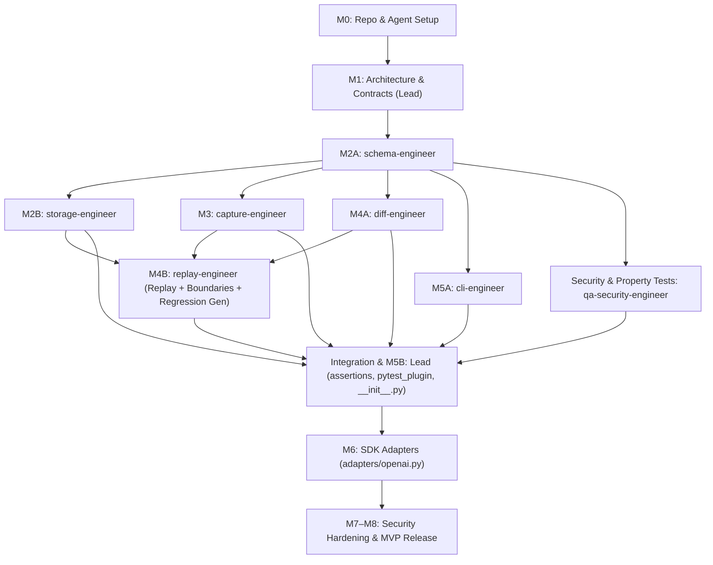

# TraceVault Multi-Agent Workflow

This document defines how the **Lead Architect / Orchestrator** and the seven workspace custom subagents under [`.agents/agents/`](../.agents/agents/) execute TraceVault milestones safely in parallel without interface drift or merge collisions.

---

## 1. Explicit Subsystem & Artifact Ownership

| Responsibility Area | Owner | Writable Paths | Forbidden Paths |
|---|---|---|---|
| **Architecture, Contracts, Root Config, Public Wiring** | **Lead Architect** | `pyproject.toml`, `README.md`, `LICENSE`, `.gitignore`, `.github/**`, `docs/ARCHITECTURE.md`, `docs/CONTRACTS.md`, `docs/AGENT_WORKFLOW.md`, `docs/ROADMAP.md`, `src/tracevault/__init__.py`, `examples/**` | Delegates core subsystems to module owners |
| **Schema** (models, interactions, errors, validation, redaction, fingerprint) | `schema-engineer` | `src/tracevault/schema/**`, `tests/schema/**`, `docs/SCHEMA.md` | All other `src/**`, `tests/**`, shared root/contract files |
| **Storage** (filesystem JSON store, atomic writes, SQLite index, import/export) | `storage-engineer` | `src/tracevault/storage/**`, `tests/storage/**` | All other `src/**`, `tests/**`, shared root/contract files |
| **Capture & Instrumentation** (sync/async session, context propagation, decorators) | `capture-engineer` | `src/tracevault/capture/**`, `tests/capture/**` | All other `src/**`, `tests/**`, shared root/contract files |
| **Replay & Boundaries** (offline fixture replay, fork, boundary policies, regression test gen) | `replay-engineer` | `src/tracevault/replay/**`, `tests/replay/**` | All other `src/**`, `tests/**`, shared root/contract files |
| **Diff** (structural trace comparison, divergences, formatters) | `diff-engineer` | `src/tracevault/diff/**`, `tests/diff/**` | All other `src/**`, `tests/**`, shared root/contract files |
| **CLI** (Typer + Rich command-line entrypoint) | `cli-engineer` | `src/tracevault/cli/**`, `tests/cli/**` | All other `src/**`, `tests/**`, shared root/contract files |
| **pytest Integration & Assertions** (`assertions`, `pytest_plugin`, regression runner integration) | **Lead Architect** *(or delegated post-M4 via explicit assignment)* | `src/tracevault/assertions/**`, `src/tracevault/pytest_plugin/**`, `tests/assertions/**`, `tests/pytest_plugin/**` *(plus `replay-engineer` on `src/tracevault/replay/regression.py`)* | Subsystem internals outside public APIs |
| **SDK / Framework Adapters** (`TraceAdapter`, OpenAI SDK wrapper) | **Lead Architect** *(or delegated in M6 via explicit assignment)* | `src/tracevault/adapters/**`, `tests/adapters/**` | `storage/**` internals, `diff/**`, `cli/**`, `schema/**` |
| **Security & QA** (adversarial tests, AST checks, property tests, integration validation) | `qa-security-engineer` | `tests/security/**`, `tests/conftest.py`, `docs/SECURITY.md`, assigned `tests/integration/**` | **ALL `src/**` (strictly read-only)**, shared root/contract files |
| **Documentation** | Shared by explicit slice | Lead: `README.md`, `ARCHITECTURE.md`, `CONTRACTS.md`, `AGENT_WORKFLOW.md`, `ROADMAP.md`; `schema-engineer`: `docs/SCHEMA.md`; `qa-security-engineer`: `docs/SECURITY.md` | Cross-owned docs without Lead approval |

---

## 2. Dependency Order & Parallel Execution Waves



### Parallelism Rules
- **Prior Contract Gate (Sequential)**: **M1** (`docs/CONTRACTS.md` and `docs/ARCHITECTURE.md`) must be complete and committed before any implementation agent starts.
- **Schema Gate (Sequential)**: `schema-engineer` runs first (**M2A**) and is reviewed/merged to `main` before downstream agents branch or implement against real schema imports.
- **Parallel Wave 1** *(after `schema` merges)*: `storage-engineer`, `capture-engineer`, `diff-engineer`, `cli-engineer` (using lazy imports for `ReplayEngine` and `generate_pytest_regression`), and `qa-security-engineer` (`tests/conftest.py`, `docs/SECURITY.md`, schema/storage security tests) run safely in parallel in isolated worktrees.
- **Parallel Wave 2**: Once `schema` and `diff` contracts/code are stable on `main`, `replay-engineer` implements `ReplayEngine`, `boundaries.py`, and `regression.py` in parallel with remaining `cli` or `qa-security` work.
- **Sequential Integration & M5/M6**: Lead integrates branches, implements/verifies `assertions`, `pytest_plugin`, and `adapters`, and runs M7/M8 hardening and release validation.

---

## 3. Shared Files & Simultaneous-Edit Prevention

The following files are **never edited concurrently by subagents**:
- **Lead-only**: `pyproject.toml`, `README.md`, `LICENSE`, `.gitignore`, `.github/workflows/*`, `docs/ARCHITECTURE.md`, `docs/CONTRACTS.md`, `docs/AGENT_WORKFLOW.md`, `docs/ROADMAP.md`, `src/tracevault/__init__.py`, `examples/*`.
- **QA-only**: `tests/conftest.py` (module-specific unit tests must place local helpers inside their own `tests/<module>/` folder rather than editing `tests/conftest.py`).

### When Agents Must Stop and Ask (Never Invent Interfaces)
An agent **must stop immediately and escalate to the Lead** instead of guessing if:
1. `docs/CONTRACTS.md` is missing or omits a required field/signature/error type.
2. An upstream dependency (e.g., `tracevault.schema`) has not yet been merged to its workspace base.
3. Implementing a feature reveals a genuine contradiction or missing dependency in `pyproject.toml` or `docs/CONTRACTS.md`.
4. A test in `qa-security-engineer` or `cli-engineer` uncovers a bug inside another agent's `src/tracevault/<module>/` (report the failing reproduction rather than editing across ownership boundaries).

---

## 4. Worktree Isolation, Integration & Conflict Resolution

### Worktree Usage
1. Ensure `main` has a clean committed baseline (`git commit`) before spawning parallel agents.
2. Launch each parallel implementation agent in its own isolated git worktree (`workspace: "share"` / branch `agent/<name>/<milestone>`).
3. Enforce a **single-writer rule**: two concurrent agents must never write to the same worktree or overlapping directories.

### Integration & Conflict Resolution Protocol
1. **Diff Inspection**: Lead checks `git diff --name-status main...<agent-branch>` to confirm zero edits outside the agent's owned paths. Out-of-scope edits are rejected or reverted before merge.
2. **Contract Verification**: Lead verifies every exported class, enum, field (`extra="forbid"`), and function signature matches `docs/CONTRACTS.md`.
3. **Incremental Merge**: Merge one branch at a time (`git merge --no-ff <agent-branch>` or clean commit apply) onto `main`.
4. **Conflict Resolution**:
   - Because directory ownership is disjoint, true text conflicts should only occur if an agent violates ownership or if `docs/CONTRACTS.md` was updated mid-wave.
   - If Lead approves a contract update on `main`, Lead updates `docs/CONTRACTS.md` (and `schema` if applicable) first; active agents then rebase onto `main` before continuing.
5. **Worktree Cleanup**: Remove merged temporary branches/worktrees once post-merge checks pass.

---

## 5. How Tests & Quality Gates Are Executed

### Per-Agent Pre-Report Gate (Mandatory)
Every implementation agent must run and report actual output for its owned slice:
```bash
uv run pytest tests/<owned_module> -v
uv run ruff check src/tracevault/<owned_module> tests/<owned_module>
uv run mypy src/tracevault/<owned_module>
```
*(For `qa-security-engineer`: `uv run pytest tests/security -v` and `uv run ruff check tests/security tests/conftest.py`.)*

### Lead Post-Merge Integration Gate (Mandatory)
After every merge checkpoint and before closing a milestone, the Lead runs the full verification suite on `main`:
```bash
uv run pytest -v
uv run ruff check src tests
uv run ruff format --check src tests
uv run mypy src
```
No milestone is marked complete unless every command passes with zero skipped/relaxed assertions and zero unapproved warnings.
