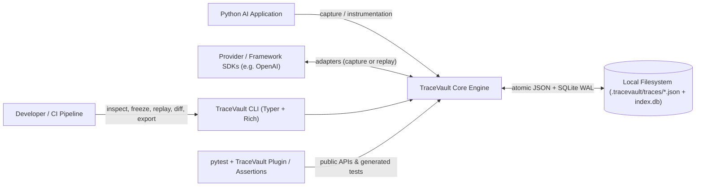
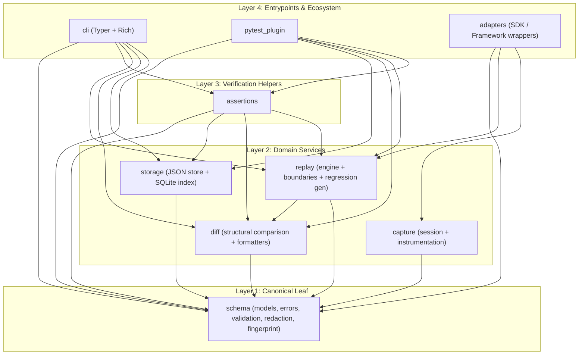
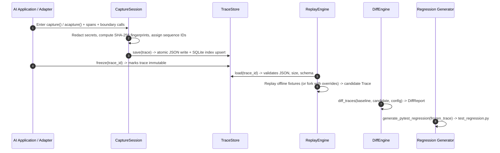

# TraceVault Architecture

**Status**: M1 Architecture Baseline  
**Target Runtime**: Python 3.12+  
**Authoritative Contracts**: [`docs/CONTRACTS.md`](./CONTRACTS.md)

---

## 1. Product Scope & Boundaries

**TraceVault** is a local-first, open-source AI execution capture, deterministic replay, structural comparison, and regression-testing engine. It turns nondeterministic production failures into reproducible local test cases without requiring cloud infrastructure or LLM-as-a-judge evaluators.

### Core Workflow

```text
Production failure → Capture → Freeze → Replay → Fork → Compare → Verify fix → Regression test
```

### Design Goals
- **Framework- & provider-agnostic core**: Canonical Pydantic v2 trace schema independent of any LLM SDK or agent framework.
- **Python-first & local-first**: Single-process library and CLI operating directly on local disk.
- **Offline deterministic fixture replay**: Recorded model, tool, and retrieval responses replay deterministically with zero external network calls by default.
- **Explicit boundary replay**: Live boundary execution (model, tool, retrieval) is strictly opt-in and fail-closed via `SafetyPolicy`.
- **Deterministic structural diffing**: Reproducible tree/sequence comparison with severity classification (`info`, `warning`, `breaking`) and ignore-path filtering.
- **Portable regression tests**: Export frozen traces into standalone `pytest` regression tests and reusable assertions.
- **Secure trace handling**: Strict schema validation (`extra="forbid"`), path traversal containment, depth/size caps, automatic secret redaction, and zero `pickle`/`eval`/`exec`.
- **Extensible adapter architecture**: Clean provider/framework adapter boundaries decoupled from core storage and replay internals.

### Explicit MVP Non-Goals (Excluded)
The MVP explicitly excludes:
- Hosted SaaS control plane or multi-tenant cloud backend
- Mandatory cloud object storage or remote telemetry ingestion
- Distributed tracing clusters, microservices, or message brokers (Kubernetes, Kafka, Redis)
- External database servers (PostgreSQL) — local SQLite only
- Web UI / browser dashboard (CLI + Rich + Python APIs only)
- Mandatory LLM evaluator / LLM-as-a-judge scoring
- Automatic live re-execution of side-effecting models/tools without explicit `SafetyPolicy` authorization

---

## 2. System Context



---

## 3. Layered Architecture & Dependency Direction

TraceVault follows a strict acyclic layered architecture. Dependencies flow **downward only** toward `schema`.



### Mandatory Dependency Rules
1. `schema` **must not** import or depend on `storage`, `capture`, `adapters`, `replay`, `diff`, `assertions`, `pytest_plugin`, or `cli`.
2. `storage` **must not** contain replay matching, boundary policy, or comparison business logic.
3. `diff` **must** operate purely on canonical `Trace` objects and **must not** depend on `storage`, `capture`, `replay`, or `adapters`.
4. `adapters` **must not** bypass `capture`/`replay` public APIs or touch `storage` internals (`index.db` or raw file paths).
5. `cli` **must** invoke domain services (`TraceStore`, `ReplayEngine`, `diff_traces`, `generate_pytest_regression`, `verify`) rather than implementing core business logic in CLI handlers.
6. `pytest_plugin` and `assertions` **must** operate strictly through public APIs of `schema`, `storage`, `replay`, and `diff`.
7. Shared contracts in [`docs/CONTRACTS.md`](./CONTRACTS.md) **must never** be independently redefined by subsystem modules or agents.

---

## 4. Component Responsibilities & Module Boundaries

| Logical Subsystem | Physical Package / Files | Responsibility |
|---|---|---|
| `schema` | `src/tracevault/schema/` (`models.py`, `interactions.py`, `errors.py`, `validation.py`, `redaction.py`, `fingerprint.py`) | Canonical Pydantic v2 models, enums, error hierarchy, schema versioning, JSON safety/depth validation, `trace_id` validation, SHA-256 request fingerprinting, recursive secret redaction. |
| `storage` | `src/tracevault/storage/` (`repository.py`, `store.py`, `index.py`) | `TraceRepository` protocol, `TraceStore` local JSON persistence, atomic temp-file writes, freeze immutability, SQLite WAL index (`index.db`), query filtering, JSON/JSONL export, validated import, reindexing. |
| `capture` & `instrumentation` | `src/tracevault/capture/` (`session.py`, `context.py`, `decorators.py`) | Sync/async `CaptureSession` (`capture`, `acapture`), `contextvars` propagation across nested spans and `asyncio.gather`, monotonic event sequencing, automatic `FixtureEntry` extraction, default redaction, and `@trace_*` decorators. |
| `replay` & `boundaries` | `src/tracevault/replay/` (`engine.py`, `boundaries.py`, `regression.py`) | Offline deterministic `ReplayEngine`, strict/lenient fixture matching, fork/override support, `ReplayResult`, `ModelBoundary`/`ToolBoundary`/`RetrievalBoundary`, fail-closed `SafetyPolicy` enforcement, and `generate_pytest_regression`. |
| `diff` | `src/tracevault/diff/` (`engine.py`, `formatter.py`) | `diff_traces` structural comparison of runs, spans, events, interactions, and fixtures; `DiffConfig` & `ignore_paths`; severity classification; deterministic ordering; text/JSON/Rich formatters. |
| `assertions` | `src/tracevault/assertions/` (`trace.py`, `replay.py`, `diff.py`) | Reusable Python & pytest assertion functions (`assert_trace_valid`, `assert_replay_succeeded`, `assert_no_breaking_diffs`, etc.) producing rich failure diagnostics. |
| `pytest_plugin` | `src/tracevault/pytest_plugin/` (`plugin.py`) | `pytest` fixtures (`tracevault_store`, `tracevault_replay`), markers, and helper hooks built strictly on public TraceVault APIs. |
| `adapters` | `src/tracevault/adapters/` (`base.py`, `openai.py`, ...) | `TraceAdapter` protocol/base class and provider/framework SDK adapters (e.g., OpenAI sync/async client wrapper) decoupling SDK payloads from canonical `Trace` contracts. |
| `cli` | `src/tracevault/cli/` (`app.py`) | Typer + Rich command-line application (`init`, `list`, `show`, `freeze`, `replay`, `diff`, `export-test`, `verify`, `delete`) with machine-readable `--json` output and CI-friendly exit codes. |

---

## 5. End-to-End Data Flow



---

## 6. Storage Design

Default repository location: `<project_root>/.tracevault/` (overridable via `--store` or `TraceStore(base_dir=...)`).

```text
.tracevault/
├── index.db                 # SQLite metadata index (WAL mode, parameterized SQL)
└── traces/
    ├── <trace_id>.json      # Canonical UTF-8 JSON trace (authoritative source of truth)
    └── ...
```

### Storage Mechanics & Invariants
- **JSON as Source of Truth**: Portable `.json` files hold the full trace. `index.db` is purely an acceleration index and can be deleted and rebuilt deterministically via `TraceStore.reindex()`.
- **Atomic Writes**: `save()` serializes with `allow_nan=False`, writes to a temporary file inside `traces/` via `tempfile.NamedTemporaryFile(dir=traces_dir, delete=False)`, flushes, and replaces atomically using `os.replace()`. If SQLite indexing fails after write on a new trace, the temporary/new artifact is cleaned up or reconciled consistently.
- **SQLite WAL Index**: Configured with `PRAGMA journal_mode=WAL; PRAGMA synchronous=NORMAL; PRAGMA foreign_keys=ON;` and strictly parameterized queries (`?` placeholders) storing `trace_id`, `root_run_id`, `run_name`, `status`, `created_at`, `frozen`, `parent_trace_id`, counts, and normalized tag mappings.
- **Freeze Immutability**: Once `frozen=True`, `save(..., overwrite=True)` raises `TraceFrozenError` and `delete()` raises `TraceFrozenError` unless `force=True` is explicitly supplied.
- **Portability**: `export_trace()` writes JSON or JSONL (line 1 header + ordered events). `import_trace()` reads external files through the exact same byte-limit, non-finite JSON, and Pydantic schema validation pipeline as `load()`.

---

## 7. Capture Lifecycle

1. **Session Start**: `capture(name, ...)` / `acapture(name, ...)` creates a `CaptureSession`, initializes the root `Run` (`status=RUNNING`), records `RUN_STARTED`, and binds the session in a `contextvars.ContextVar`.
2. **Span Nesting & Concurrency**: `session.span()` / `session.aspan()` pushes a `Span` onto a `ContextVar`-backed immutable tuple stack (`parent_span_id` inferred from top of stack), ensuring concurrent `asyncio.gather` coroutines never corrupt sibling span stacks.
3. **Boundary & Event Recording**:
   - Every event increments an atomic monotonic `sequence` counter scoped to the `CaptureSession`.
   - Boundary helpers (`record_model_call`, `record_tool_call`, `record_retrieval`) simultaneously record structured events and emit a `FixtureEntry` containing `boundary`, `compute_fingerprint(boundary, redacted_request)`, per-key `call_index`, `request`, `response`, `error`, `span_id`, and `name`.
4. **Secret Redaction**: When `redact=True` (default), `redact_data()` scrubs inputs, outputs, attributes, event payloads, environment keys, and fixture payloads before freezing them into immutable `TraceVaultModel` instances.
5. **Finalization**: On normal exit, `Run.status` transitions to `COMPLETED` (with `RUN_COMPLETED`); on unhandled exception, `ExecutionError` is captured, `Run.status` transitions to `FAILED` (`RUN_FAILED`), the trace is built (and auto-saved if `auto_save=True`), `ContextVar` tokens are reset in `finally`, and the exception propagates cleanly.

---

## 8. Replay & Boundary Architecture

### Offline Fixture Replay (`ReplayEngine`)
1. **Default Offline Guarantee**: `ReplayEngine` never imports network clients, invokes subprocesses, or calls live APIs.
2. **Matching Algorithm**:
   - Normalized lookup key in strict mode (`ReplayMode.OFFLINE_STRICT`): `(boundary, fingerprint, call_index)` where `fingerprint = compute_fingerprint(boundary, redacted_request)` and `call_index` increments per `(boundary, fingerprint)` within a replay pass.
   - Lenient mode (`ReplayMode.OFFLINE_LENIENT`): tries exact strict match first; if absent, falls back to `(boundary, name, call_index)` when `name` is provided, then `(boundary, call_index)` for that boundary stream.
   - **Overrides**: Before returning a fixture response, `ReplayConfig.overrides` is checked by `fixture_id`, `fingerprint`, or `(boundary, name, call_index)`.
   - **Errors & Missing Fixtures**: If the matched fixture recorded an `error` with `response is None`, `ReplayError` is raised. If no fixture matches and `fail_on_missing_fixture=True`, `FixtureNotFoundError` is raised.
3. **Forking**: `fork()` / `replay_trace(fork=True)` creates a non-frozen child `Trace` with `parent_trace_id = baseline.trace_id`, preserving lineage for comparison.

### Policy-Governed Boundary Replay (`boundaries.py`)
Supports three explicit MVP boundaries:
- `ModelBoundary` (`BoundaryType.MODEL`)
- `ToolBoundary` (`BoundaryType.TOOL`)
- `RetrievalBoundary` (`BoundaryType.RETRIEVAL`)

Decision flow for every boundary invocation:
1. Check `config.boundary_modes.get(boundary, BoundaryMode.RECORDED)`:
   - `DENY` → raise `PolicyViolationError` immediately.
   - `RECORDED` → delegate strictly to `ReplayEngine.replay_interaction(...)`.
   - `LIVE` → evaluate `SafetyPolicy` **fail-closed**:
     - `boundary` must be in `policy.allow_live_boundaries`.
     - If `policy.require_explicit_opt_in` is `True`, `policy.max_live_calls` must be `> 0`.
     - `live_calls_executed < policy.max_live_calls`.
     - For `TOOL`: `tool_name` must be in `policy.allowed_tools` (empty set = none allowed).
     - For `MODEL` / `RETRIEVAL`: if `host` is supplied (or required by policy when `allowed_hosts` is configured), `host` must be in `policy.allowed_hosts`.
     - Only after all checks pass is the caller-supplied live handler invoked, its count incremented, and its sanitized result recorded.

---

## 9. Diff Architecture

`diff_traces(baseline, candidate, config=...)` performs deterministic structural comparison without LLM evaluators:
1. **Run Comparison**: compares `runs` count, statuses (`STATUS_CHANGED` → `BREAKING`), outputs (`OUTPUT_CHANGED` → `BREAKING`), and errors (`ERROR_CHANGED` → `BREAKING`).
2. **Span Comparison**: aligns spans by structural path/name (`SPAN_REMOVED` → `BREAKING`, `SPAN_ADDED` → `WARNING`, `SPAN_ORDER_CHANGED` → `WARNING`, span status/error changes → `BREAKING`).
3. **Event & Interaction Comparison**: aligns events by sequence/type/boundary (`MODEL_OUTPUT_CHANGED` → `BREAKING`, `TOOL_ARGS_CHANGED` → `BREAKING`, `MODEL_INPUT_CHANGED` → `WARNING`, `EVENT_ADDED`/`EVENT_REMOVED`/`EVENT_PAYLOAD_CHANGED` → `WARNING`).
4. **Fixture Comparison**: checks `FixtureSet` entries (`FIXTURE_MISMATCH` → `BREAKING`).
5. **Filtering & Ordering**: drops paths matching `ignore_paths` (and volatile timestamps/IDs when configured in `DiffConfig`), sorts divergences deterministically by `(severity_rank, path, kind)`, computes `summary` counts (`info`, `warning`, `breaking`, `total`), and sets `identical = (len(divergences) == 0)`.

---

## 10. Adapter Architecture

Adapters bridge external SDKs/frameworks (e.g., OpenAI Python SDK) to TraceVault without polluting the core:
- **Decoupling**: Core modules (`schema`, `storage`, `capture`, `replay`, `diff`) never depend on `openai` or any AI framework. Adapters are optional extras (`tracevault[openai]`).
- **Interface**: Every adapter implements `TraceAdapter` (`name`, `adapter_version`, `supported_sdk_versions`, `boundary`, `attach(...)`, `detach(...)`).
- **Dual Mode**: An adapter integrates with either an active `CaptureSession` (to record sanitized boundary interactions), a `ReplayEngine` / `BoundaryExecutor` (to short-circuit network calls with recorded fixtures), or both (capture forked execution during replay).
- **Zero Storage Coupling**: Adapters emit events/fixtures via `CaptureSession` or consume fixtures via `ReplayEngine`; they never read or write `.tracevault/` directly.

---

## 11. CLI & `pytest` Integration Architecture

### CLI (`tracevault.cli.app`)
- Built with **Typer** + **Rich**, exposing thin commands (`init`, `list`, `show`, `freeze`, `replay`, `diff`, `export-test`, `verify`, `delete`).
- Each command instantiates `TraceStore(base_dir=store)` and delegates directly to `storage`, `replay`, `diff`, and `assertions`.
- Domain errors (`TraceVaultError`) are caught cleanly at the CLI boundary, rendered safely without secret leakage, and exit non-zero (`1` for breaking diff or domain failures, `2` for invalid CLI usage).

### `pytest` Integration (`assertions` + `pytest_plugin` + `regression`)
1. **Generated Standalone Regression Tests**: `generate_pytest_regression()` emits self-contained Python tests using `json.dumps` for all literals (preventing code injection), loading the frozen trace and asserting offline replay yields zero `BREAKING` divergences.
2. **Assertion Library (`tracevault.assertions`)**: Framework-friendly Python assertions (`assert_trace_valid`, `assert_replay_succeeded`, `assert_no_breaking_diffs`, etc.) usable in any test runner.
3. **Pytest Plugin (`tracevault.pytest_plugin`)**: Registers fixtures (`tracevault_store`, `tracevault_replay`) and custom failure formatting via public TraceVault APIs (`pytest11` entry point optional/additive in M5).

---

## 12. Security Boundaries

1. **Zero Unsafe Deserialization or Code Execution**: Only UTF-8 JSON parsed with strict finite-number handling (`allow_nan=False` / `parse_constant` rejection) and validated through Pydantic `extra="forbid"`. Static AST tests enforce zero `pickle`, `marshal`, `shelve`, `eval`, `exec`, `os.system`, or `subprocess(..., shell=True)`.
2. **Path Containment**: `trace_id` matches `^[A-Za-z0-9][A-Za-z0-9_-]{0,127}$`. Storage and CLI verify `target.resolve().is_relative_to(base.resolve())` and reject symlinks escaping the store if encountered.
3. **Resource / DoS Guards**: `max_trace_bytes` (default 50 MiB) checked before parsing/writing; `max_depth` (default 64) checked by `validate_json_safe` to avoid `RecursionError` on hostile payloads.
4. **Default Secret Redaction**: Credentials matching sensitive keys (`api_key`, `authorization`, `token`, `secret`, `password`, etc.) or known token formats (`sk-...`, `Bearer ...`, `AKIA...`, `ghp_...`, JWTs) are replaced with `"[REDACTED]"` prior to serialization.
5. **Fail-Closed Live Replay**: Live execution is disabled by default (`BoundaryMode.RECORDED`) and blocked with `PolicyViolationError` unless explicitly authorized in `SafetyPolicy`.

---

## 13. Extensibility Strategy & MVP Limitations

### Extensibility
- **New Boundaries / Interaction Types**: Add typed payload models in `schema/interactions.py`, map into `EventKind` / `BoundaryType`, and add replay adapters in `replay/boundaries.py`.
- **New Provider/Framework Adapters**: Implement `TraceAdapter` under `src/tracevault/adapters/<provider>.py` packaged as optional extras in `pyproject.toml`.
- **Schema Evolution**: `schema_version` follows SemVer (`MAJOR.MINOR.PATCH`). Readers accept matching major version `1.x.y` and reject incompatible major versions with `UnsafeTraceError` until explicit migrators are registered.

### Known MVP Limitations
- Single-machine, single-process SQLite + JSON storage (no multi-writer distributed lock manager).
- Streaming responses are captured as ordered `StreamChunkPayload` events and coalesced for MVP fixture replay rather than simulated token-by-token network timing.
- Diff structural alignment uses deterministic run/span/event matching rather than semantic fuzzy NLP similarity.

---

## 14. Architecture Decision Records (ADRs)

| ID | Decision | Rationale |
|---|---|---|
| **ADR-001** | Portable JSON files (`traces/<id>.json`) as source of truth + rebuildable SQLite WAL `index.db` | Keeps traces human-inspectable, git-diffable, and portable across machines while giving fast local queries without a database server. |
| **ADR-002** | Immutable Pydantic v2 models with `extra="forbid"` (`TraceVaultModel`) | Rejects unknown/injected fields in hostile trace files and prevents accidental in-place mutation of captured traces. |
| **ADR-003** | Canonical JSON (`sort_keys=True`, compact separators, `allow_nan=False`) → SHA-256 request fingerprinting + `call_index` | Guarantees identical multi-turn or repeated tool calls match deterministically across OSes and Python runs. |
| **ADR-004** | Fail-closed `SafetyPolicy` defaulting every boundary to `BoundaryMode.RECORDED` | Prevents accidental live API spend or destructive tool side effects during replay or CI test runs. |
| **ADR-005** | Pure structural diffing with no mandatory LLM evaluator | Keeps regression tests fast, offline, zero-cost, and 100% deterministic in CI. |
| **ADR-006** | Standalone generated pytest files + public `assertions` API over opaque snapshot blobs | Generated tests are readable, editable, code-reviewable, and safe against arbitrary code execution from trace strings. |
